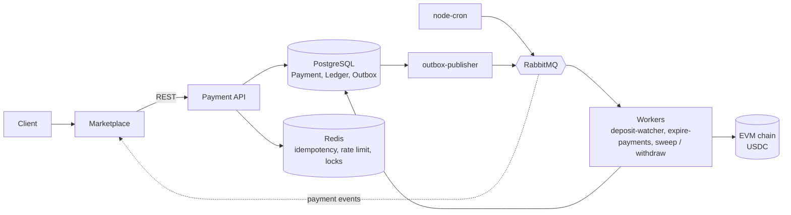
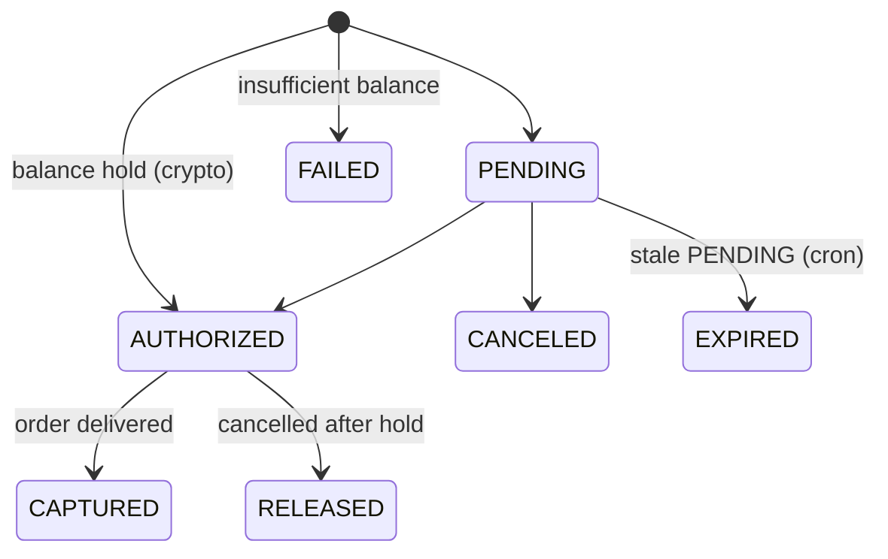

# Food Ordering Platform

A full-stack food-ordering platform built as a **TypeScript monorepo** of independent **Node.js microservices**. It is a personal portfolio project: not commercial, but designed to demonstrate production-style backend architecture and the technologies that are common in real-world backend and Web3 roles.

The system has two services:

- **Marketplace**: the main application (users, shops, products, orders, vouchers). It knows nothing about the blockchain.
- **Payment**: an independent payment microservice with its own PostgreSQL database and Prisma schema. It handles balances, a money ledger, reliable event delivery, and crypto deposits and withdrawals (USDC on EVM networks).

> **Status:** active development. The roadmap at the bottom shows what is done and what is in progress.

## Table of contents

- [Roles and permissions](#roles-and-permissions)
- [Architecture](#architecture)
- [Payment service](#payment-service)
- [Tech stack](#tech-stack)
- [Getting started](#getting-started)
- [Testing](#testing)
- [Roadmap](#roadmap)
- [Scope and security notes](#scope-and-security-notes)

## Roles and permissions

The application is role-based, and each role has its own restrictions.

| Role | Permissions |
| --- | --- |
| **Customer** | Can only order food. |
| **Owner** | Can create shops and products. |

Authentication uses JWT. Requests are validated with express-validator, and authorization is enforced through shared middlewares.

## Architecture

### Repository layout

```
.
├── apps/
│   ├── marketplace/     # Main app: users, shops, products, orders, vouchers
│   └── payment/         # Payment microservice (own Postgres + Prisma schema)
├── packages/            # Shared packages
│   ├── auth
│   ├── constants
│   ├── errors
│   ├── logger
│   ├── middlewares
│   └── validation
├── docker-compose.yml   # Local infrastructure (e.g. payment-db-test)
└── .github/workflows/   # CI (GitHub Actions)
```

The repository is a **pnpm workspace**. Shared code lives in `@packages/*` and is consumed by both services, so authentication, validation, logging, and error handling stay consistent.

### Service topology



Key architectural decisions:

- **Separate data ownership.** The Payment service has its own PostgreSQL database and Prisma schema.
- **Postgres is the only source of truth for money.** Redis is never used for balances.
- **Events are published reliably** through a transactional outbox.
- **RabbitMQ** carries inter-service events and background jobs. BullMQ and Kafka are intentionally not used.

## Payment service

### Crypto model

The model is **custodial**: users never connect a wallet.

- Each user gets a **unique deposit address**, derived from a single master key with HD derivation (BIP-32 / BIP-39).
- A user deposits once, and without a deposit they cannot buy. A watcher tracks incoming ERC-20 `Transfer` events with **viem** and credits the ledger after **N confirmations** (`PENDING` → `CONFIRMED`). Uniqueness on `[txHash, logIndex]` prevents double-crediting.
- **Payments for orders are off-chain**: they are balance movements in the database. Gas is only spent on deposit, sweep, and withdraw.
- Tokens sit on the derived child addresses, so a separate **sweep** job moves them to a hot wallet. For ERC-20 tokens, native currency is topped up for gas first. The balance in the database is credited immediately, and the sweep runs as its own task.
- Network: **EVM**, token: **USDC**. Local development uses an **Anvil (Foundry)** chain in Docker, and Sepolia can be added later.

Private keys come from a **`KeyProvider`** interface with an implementation that reads from `.env`. KMS and Vault are a deliberate non-goal for this demo project.

### Payment lifecycle

`POST /payments` checks that `available >= amount`. If so, it applies `available -= amount` and `held += amount` and sets the status to `AUTHORIZED`. Otherwise the status is `FAILED`.

| Operation | Effect |
| --- | --- |
| **capture** | `held -= amount`, the recipient is credited (order delivered) |
| **release** | `held → available` (order cancelled after the hold) |
| **refund** | the movement is reversed, in full or in part |

Every operation runs in **one database transaction** with `SELECT ... FOR UPDATE` on the balance row.



Payment status changes follow an **explicit state machine**. Refunds are tracked separately (`refundedAmount + amount <= amount`).

**Open design question:** who receives the money at capture (courier, company, fee). The plan is to add `toUserId` or a list of recipients.

### Reliability rules

- **Amounts are `BigInt`** and are serialized as strings in JSON.
- **All money operations are idempotent.** The `Idempotency-Key` header plus a `requestHash` are used, and the same key with a different body returns `409` or `422`. Idempotent responses are cached in Redis.
- **Ledger**: `LedgerEntry` + `Balance` in Postgres. The journal records every movement of money, and the balance is derived from it.
- **Transactional outbox**: an event is written in the same transaction as the status change. A separate worker publishes it to RabbitMQ.
- **Idempotent consumers**: events are stored in `PaymentEvent` with a unique `[provider, providerEventId]`.
- **Retries, dead-letter queues, and delayed jobs** are handled through RabbitMQ.
- **Service-to-service authentication** uses JWT or an API key.
- **Secrets and keys are never logged.**
- **Rate limiting** and **distributed locks** are implemented with Redis.

### API

| Method | Route | Purpose |
| --- | --- | --- |
| `POST` | `/payments` | Create a payment (`Idempotency-Key`). `PENDING`, or immediately `AUTHORIZED` for crypto. |
| `GET` | `/payments/:id` | Payment status. |
| `GET` | `/payments?orderId=&userId=&status=` | Search and history. |
| `POST` | `/payments/:id/capture` | `AUTHORIZED` → `CAPTURED` (order delivered). |
| `POST` | `/payments/:id/release` | `AUTHORIZED` → `RELEASED` (cancelled after hold). |
| `POST` | `/payments/:id/cancel` | `PENDING` → `CANCELED`. |
| `POST` | `/payments/:id/refund` | Full or partial refund. |
| `GET` | `/payments/:id/refunds`, `/refunds/:id` | Refund details. |
| `POST` | `/webhooks/stripe` | Signature verification, raw body, saved to `PaymentEvent`, fast `200`. |
| `POST` | `/webhooks/mock` | Dev only. |
| `GET` | `/health` | Health check. |
| `GET` | `/payments/:id/events` | Payment events (admin). |
| `GET` | `/crypto/deposit-address` | User's deposit address. |
| `GET` | `/balances/:userId` | Available and held balance. |
| `POST` / `GET` | `/withdrawals` | Create and list withdrawals (with limits). |

The OpenAPI documentation is served with **Swagger UI**.

### Background workers

Workers consume jobs from RabbitMQ. `node-cron` triggers periodic runs by putting jobs into the queue.

| Worker | Responsibility |
| --- | --- |
| `deposit-watcher` | Reads chain events with viem and credits the ledger. |
| `outbox-publisher` | Publishes outbox events to RabbitMQ for the Marketplace. |
| `expire-payments` | Moves stale `PENDING` payments to `EXPIRED`. |
| `sweep` / `withdraw` | Moves funds to the hot wallet and sends withdrawals. |

### Data model

| Area | Entities |
| --- | --- |
| Payments | `Payment`, `Refund`, `PaymentEvent` |
| Ledger | `Balance`, `LedgerEntry` |
| Events | `Outbox` |
| Crypto | `DepositAddress`, `Deposit`, `Withdrawal` |

### Observability

- **End-to-end `requestId`** (via `AsyncLocalStorage`) is carried through logs, queues, and events.
- Structured logging with **pino** and **pino-http**.
- **Prometheus** metrics at `/metrics`: errors, queue length, and watcher lag.
- A single, unified error format across services.

## Tech stack

| Area | Technology | Status |
| --- | --- | --- |
| Runtime and language | Node.js 22, TypeScript | In use |
| HTTP | Express 5, express-validator | In use |
| Database | PostgreSQL, Prisma 7 (adapter-pg) | In use |
| Auth | jsonwebtoken (JWT), bcrypt | In use |
| Logging | pino, pino-http | In use |
| Testing | Jest, Supertest | In use |
| Tooling | pnpm workspaces, esbuild, tsx, nodemon, ESLint | In use |
| Infrastructure | Docker Compose, GitHub Actions | In use |
| Cache and locks | Redis (ioredis) | Planned |
| Messaging | RabbitMQ (amqplib) | Planned |
| Scheduling | node-cron | Planned |
| Reliability patterns | Transactional outbox, ledger | Planned |
| Blockchain | viem, @scure/bip32, @scure/bip39 | Planned |
| Key management | `KeyProvider` interface (`.env` implementation) | Planned |
| Observability | `AsyncLocalStorage` requestId, prom-client | Planned |
| API docs | swagger-ui-express (OpenAPI) | Planned |
| Integration testing | Testcontainers, Anvil (Foundry) | Planned |

## Getting started

**Prerequisites:** Node.js 22, pnpm, Docker.

```bash
git clone https://github.com/DaniilSapielkin01/NodeJS_food-app.git
cd NodeJS_food-app

# install all workspace dependencies
pnpm install

# start the test database for the Payment service
docker compose up -d payment-db-test
```

Each service reads its configuration from a `.env` file (database URL, JWT secret, and so on). Run the services and tests with pnpm's workspace filters:

```bash
# run the Payment service in development mode
pnpm --filter ./apps/payment dev

# run the Marketplace service in development mode
pnpm --filter ./apps/marketplace dev
```

## Testing

- **Current:** unit and HTTP tests with **Jest** and **Supertest**, against a real PostgreSQL test database started by Docker Compose.
- **Planned:** integration tests with **Testcontainers** (real Postgres, Redis, and RabbitMQ) and an **Anvil** local chain for deposit, sweep, and withdrawal flows.

```bash
pnpm --filter ./apps/payment test
pnpm --filter ./apps/marketplace test
```

## Roadmap

- [x] pnpm monorepo with shared `@packages/*`
- [x] Marketplace service: users, shops, products, orders, vouchers
- [x] JWT authentication and role-based access control (customer / owner)
- [x] Payment service scaffold: schema (`Payment`, `Refund`, `PaymentEvent`), health route, initial migration, test database
- [x] Docker Compose and GitHub Actions CI
- [ ] Payment routes and explicit state machine
- [ ] `requestId` propagation and a unified error format
- [ ] Redis: idempotency and rate limiting
- [ ] Ledger and balances, then hold / capture / release / refund on top of them
- [ ] RabbitMQ, transactional outbox, and node-cron jobs
- [ ] Crypto: address derivation, deposit watcher with confirmations, sweep (on Anvil)
- [ ] Withdrawals with limits, Prometheus metrics, Swagger / OpenAPI

## Scope and security notes

This is a **demo project for a portfolio**. It is built to show architecture and engineering practices, and it is **not intended to hold real funds**. Local and test networks only. Keys come from `.env` through the `KeyProvider` interface. A production setup would replace this with a managed key service (KMS or Vault), which is intentionally out of scope here.

## Author

**Daniil Sapielkin**, Front-End / Full-Stack Developer · [GitHub](https://github.com/DaniilSapielkin01)
